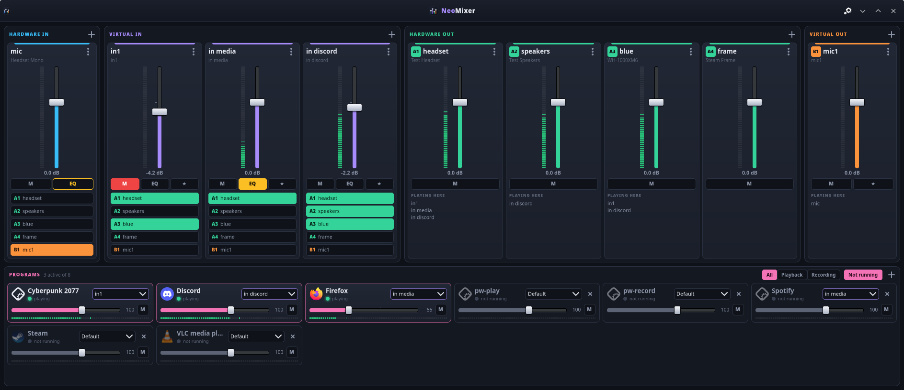
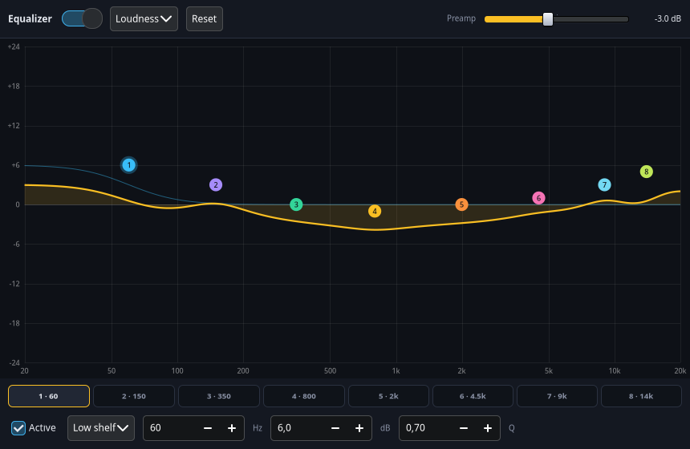

# NeoMixer

A virtual audio mixer for PipeWire with Voicemeeter's workflow: channel strips, A/B routing, a
parametric EQ on every input, and programs that stay where you put them.



NeoMixer is a fork of [Pulsemeeter](https://github.com/theRealCarneiro/pulsemeeter) by Gabriel
Carneiro. It imports your Pulsemeeter config on first start.

## What it adds to Pulsemeeter

- **Programs are always listed.** Everything that connects to the sound server stays in the list,
  whether it plays, sits there silently or is not running at all. You can set a program up while it
  is off, or add one with **+** before it ever played anything.
- **Program routing is remembered.** A program's output, input, volume and mute are saved per
  program, and applied whenever its streams appear: on restart, after a reboot, or when the device
  it belongs on comes back.
- **Equalizer on every channel.** Eight parametric bands with a live curve, presets and a preamp, on
  inputs and outputs. Changes are inaudible to apply, and switching it off is instant, for comparing.
- **Text size that means something.** Set in points, it comes out the same physical size on every
  monitor, from the size each monitor reports, and follows the window when it moves to another.
- **The default device stays yours.** A lock on a virtual strip holds it as the default: when
  something else changes the default, as Steam does when the Frame connects, it switches back.
- **Reboots lose nothing.** Settings are saved as they change, also on SIGTERM. Virtual devices get
  their volume, mute and primary state back. It recovers by itself if the sound server restarts.
- **A layout that holds up.** Strips share the window width and programs flow into a grid of their
  own, however many there are the faders stay put and nothing scrolls sideways.
- **Starts at login**, from a switch in the settings, and keeps running in the tray when closed.



## Install

| | |
|---|---|
| CachyOS | `sudo pacman -U neomixer-*.pkg.tar.zst` |
| Fedora | `sudo dnf install ./neomixer-*.rpm` |
| From this checkout | `pipx install .`, the first start adds the launcher to your menu |

It needs PipeWire with `pipewire-pulse`, and GTK 4, which the packages pull in. Quit Pulsemeeter
first: both would manage the same devices.

On GNOME there is no tray without the AppIndicator extension. NeoMixer still keeps running when
its window closes: start it again from the menu to get the window back.

## Using it

| | |
|---|---|
| Route an input to an output | Click **A1**, **B1**… on its strip. Right click for channel mapping and a per-route volume |
| Choose a program's output | The selector on its card. It is remembered |
| Open a channel's EQ | **EQ** on its strip. Right click switches it on or off without opening it |
| Edit the EQ | Drag a handle for frequency and gain, scroll for Q, double click to zero the gain |
| Make a device the system default | **★** on its strip |
| Keep it the default, whatever other programs do | The lock on its strip |
| Mute or change the volume with keys, from any program | Settings menu, **Hotkeys…**. Your desktop asks once to confirm new keys |
| Quit for real | Settings menu, or the tray icon's menu, or `neomixer quit` |

Closing the window keeps NeoMixer running, since new streams only reach their remembered output
while it runs. Routes and the EQ also keep playing after you quit, until you log out.

Hotkeys go through the desktop's global shortcuts portal, the one way a program gets keys on Wayland:
KDE and GNOME have it. Holding a volume key keeps going up to 0 dB, past that takes a press each. A press
toward 0 dB snaps to it when it lands within 1 dB, or would go past it; that is a setting in the same window. On a
desktop without it, bind keys in its settings to `neomixer hotkey <hi|vi|a|b> <id> <mute|up|down>`.

Files: `~/.config/neomixer/config.json` and `~/.local/state/neomixer/neomixer.log`.

## How it works

Virtual devices are PipeWire null sinks, and routes are links between their ports, which is why
audio does not depend on the app running.

A channel's EQ is a `libpipewire-module-filter-chain` in a process of its own, spliced between the
device and its routes. Its nodes are passive, so an EQ never keeps a sound card awake. Parameters
change through `pw-cli set-param` without touching the audio; only a new filter type rebuilds the
chain. Programs can also play straight into a hardware output, or follow it as the default device.
That EQ is a WirePlumber smart filter, which takes every stream headed for the device.

Programs are identified by what survives updates: the Flatpak id or process name, not the stream
name, which is `Factorio 2.1.24` today and `WEBRTC VoiceEngine` for half the internet. A stream's
target is set through the same `default` metadata store WirePlumber follows.

## Development

```sh
python -m venv --system-site-packages .venv
.venv/bin/pip install -e . pytest
.venv/bin/python -m pytest tests/unit

# The real app against a real, private sound server: real audio is measured through the EQ.
# Runs in its own PipeWire, WirePlumber, D-Bus and headless KWin, your audio is not touched.
.venv/bin/python tests/integration/lifecycle_test.py

# Hotkeys against real KDE, with real keys and its real dialog. Starts a portal, so only in a container
# (packaging/test.sh does this): .venv/bin/python tests/integration/kde_portal_test.py

# The packages, each built in a clean container of its distro, from what is committed
packaging/build.sh

# Installs them in clean containers, and runs all of the above against what got installed
packaging/test.sh
```

## License

MIT, see [LICENSE](LICENSE).
